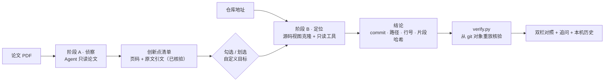
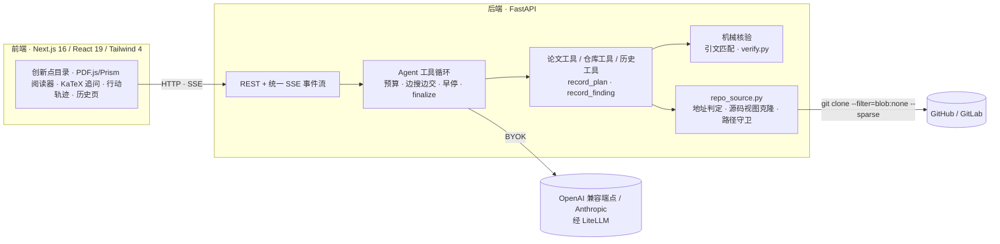

# Paper2code

**论文创新点 ↔ 代码实现的可核验对照系统**

上传一篇论文 PDF，再给出对应的代码仓库地址。Agent 会自主通读论文、探索仓库，把论文的核心创新点和代码实现逐条对应起来，并在双栏阅读器中对照展示与追问。**每条论文引文与代码引用都可由后端机械核验**；仓库里确实没有实现时，直接如实报告 `not_found`。

[](LICENSE)


---

## 为什么做这个

读论文配代码时，最耗时的往往不是“听一段泛泛的总结”，而是建立精确对应：**论文第 3 节的那个公式或模块，到底落在仓库哪个文件、哪几行？**

通用对话模型很容易写出“看起来很懂”的解读，但你很难判断它有没有编造页码、行号或函数。Paper2code 把**可核验性**做成系统底线：

- **论文侧**：每条引文都会校验是否真实出现在指定页；只匹配到开头时如实标为「部分匹配」。
- **代码侧**：每条代码引用锚定到锁定 `commit_sha`、文件路径、行区间与归一化片段哈希（`snippet_sha256` 由后端从 `git show` 对象计算，模型无权提供），后端随时可重放核验。
- **诚实性**：`not_found` 是合格输出而非失败，必须附上判断依据与已搜索记录。

定位是**帮人快速建立算法与代码之间的对应关系**，不预设阅读背景。

---

## 核心特性

- **两阶段自主 Agent 工作流**
  - **阶段 A（侦察）**：仅读论文，提炼 3–5 条核心创新点，每条附页码、已核验原文引文与代码搜索线索（`search_hints`）。
  - **阶段 B（定位）**：源码视图浅克隆仓库，逐条定位实现，产出带证据锚点与解释（直觉、公式、逐段讲解、易错点、延伸阅读）的结论。
  - **人工可控介入**：两阶段之间可自由勾选、改名、删除目标，也可直接在论文原文中划选任意片段新增为自定义定位目标。
- **双栏对照阅读器**
  - **左栏（论文）**：默认使用本地 PDF.js 渲染原版画布与官方可选文字层，保留公式/图表原貌，支持直接划选添加目标、页码直跳、多档无闪烁缩放（100%–200%）及跨行引文多矩形高亮；渲染异常时自动回退至服务端 PNG，并保留「原文文本」备用视图。
  - **右栏（代码）**：Prism 多语言语法着色，引用行高亮并支持一键「回到引用行」与「复制位置」；AI 逐段讲解按行号直接嵌入代码行前，明确标示「AI 讲解 · 非仓库原文」。
  - 阅读器顶栏支持直接切换上一条 / 下一条创新点，减少长页来回滚动。
- **可核验追问对话 & 数学公式排版**
  - 可针对当前创新点或整篇论文继续追问，Agent 可按需重新检索论文、代码与更早对话记录（每条消息独立 8 次工具预算）。
  - 回答中出现的每个 `文件:行号` 都会由后端拿去 git 对象核对，未通过的直接标红。
  - 解释与追问内置安全的 `react-markdown` + `KaTeX` 数学渲染（支持 `\(...\)`、`\[...\]`、`$...$`、`$$...$$` 与裸公式字段），流式闭合即渲染，禁 raw HTML 与受信任宏执行。
- **本机历史解读与换模型续问**
  - 所有解读自动保存到本机（含部分完成、失败与中断记录），支持在 `/history` 按标题/文件名搜索、按状态筛选、分页浏览与两步确认删除。
  - 刷新页面或重新打开历史不需要原密钥、也不会重跑旧阶段；更换来源、模型或解析语言（简体中文 / English）后可基于已有结论与对话继续追问，旧结论保持不变。
  - 同标签页刷新未完成解读不误锁只读，未完成历史也支持手动解锁继续完善定位。
- **可观测行动轨迹 & 外观定制**
  - 统一 SSE 事件流实时展示中文工具名、参数摘要、耗时、限流等待与预算提醒，运行中支持随时停止。
  - 顶部支持手动切换**系统 / 浅色 / 深色**外观主题。
- **BYOK（自带密钥）与运行治理**
  - 支持任意 OpenAI 兼容端点（OpenAI、DeepSeek、Moonshot、OpenRouter、SiliconFlow、vLLM、Ollama、one-api 等）及 Anthropic；协议差异仅封装在 `backend/app/providers.py`。
  - 内置两轮工具调用启动自检，提前拦住不支持可靠 function calling 的模型并给出可读诊断。
  - 具备工具次数/token/墙钟预算护栏、60%/85% 预算提醒（促模型边搜边交）、响应头/话术限流自适应、瞬时故障退避重试与**失败也交付已核验部分**机制。
- **仓库访问硬化**
  - 仅允许 `https://` 与域名白名单，三层地址判定兼容 TUN / fake-ip 代理与企业内网；部分克隆 + 稀疏检出（`--filter=blob:none --sparse`）只取源码视图；禁用 hooks、submodule、LFS 与符号链接，**绝不执行仓库内任何代码**。

---

## 工作原理





三条贯穿始终的设计原则：

1. **后端不做决策**：后端不做分节、不做 AST、不做公式 OCR，只提供原子只读工具与确定性校验；读哪页、搜什么、何时收敛由 Agent 自主决定。
2. **结构化提交走工具**：`record_plan` 与 `record_finding` 都是工具调用，支持实时增量推送与具体打回重写，避免最后吐大段 JSON 解析失败。
3. **一个 run 一条事件总线**：侦察、定位、追问复用同一条 SSE 流（`Last-Event-ID` / `from_id` 续传），`run_end` 永远是最后一条事件。

### 可核验性的边界

| 对象 | 核验方式 | 能证明 | 不能证明 |
|---|---|---|---|
| 论文引文 | 忽略空白差异核对是否出现在指定页（仅开头匹配标为「部分匹配」） | 原文确实出现在该页 | 该句足以支撑模型推论 |
| 代码引用 | 从 `git show <commit>:<path>` 提取行区间，归一化重算 `snippet_sha256` | 引用指向该 commit 真实存在的代码行 | 这些行在语义上完整实现了该公式 |
| 追问 `文件:行号` | 自动抽取并逐条查 git 对象核对存在性与行范围 | 代码位置真实存在 | 回答本身推理完全正确 |

语义正确性由解释字段、置信度与人工对照复核共同承担；界面上将「引用已核验」与「置信度」明确分开展示。

---

## 快速开始

### 环境要求

- **Python ≥ 3.11**（推荐 3.12，`litellm` 依赖 3.11+ 的 `typing.NotRequired`）
- **Node.js ≥ 22.13** 与 **pnpm**
- **git ≥ 2.25**（支持 `--filter=blob:none` 与稀疏检出）
- 辅助脚本基于 bash，推荐在 Linux 或 WSL 下运行

没有 Python 3.12 时可用 [uv](https://docs.astral.sh/uv/) 零侵入安装：

```bash
curl -LsSf https://astral.sh/uv/install.sh | sh
uv python install 3.12
```

### 1. 安装依赖

```bash
git clone https://github.com/Anatkhior/Paper2Code.git
cd Paper2Code

# 后端
cd backend
uv venv --python 3.12 .venv
uv pip install --python .venv/bin/python -r requirements.txt

# 前端
cd ../frontend
pnpm install
```

### 2. 零成本试用（无需 API Key）

项目内置本地假端点 `devtools/mock_provider.py` 与自洽合成夹具，可零成本跑通完整链路：

```bash
cd backend

# 首次使用：生成合成论文 PDF 与合成代码仓库
.venv/bin/python -m tests.paper_fixture
.venv/bin/python -m tests.repo_fixture

# 一键启动：后端(8000，已开启本地仓库开关) + 假端点(8123) + 前端(3000)
./scripts/dev_services.sh start
```

在浏览器打开 **http://localhost:3000**（开发模式请用 `localhost` 而非 `127.0.0.1`，避免 Next.js HMR 跨源拦截）：

1. **模型设置**：`base_url` 填 `http://127.0.0.1:8123/v1`、`api_key` 填 `mock-key`、`model` 填 `mock-model`，点击「运行自检」。
2. **上传论文**：拖入或选择 `backend/tests/fixtures/synthetic_paper.pdf`，点击「上传并开始侦察」。
3. **调整目标**：勾选创新点，或直接在「PDF 原版」上划选任意一段添加自定义目标。
4. **定位代码**：仓库地址填 `backend/tests/fixtures/sample_repo` 的**绝对路径**，点击「开始定位」。
5. **对照与追问**：在双栏阅读器查看原文高亮、代码与行内 AI 讲解，继续追问或前往「历史记录」体验恢复与换模型续问。

常用服务管理命令：

```bash
./scripts/dev_services.sh status        # 查看三服务状态（带健康检查）
./scripts/dev_services.sh logs backend  # 查看日志（backend | mock | frontend）
./scripts/dev_services.sh stop          # 停止全部服务
./scripts/dev_services.sh clean         # 仅清理可再生 PDF 缓存，保留全部历史与仓库
```

<details>
<summary>手动分别启动三个服务</summary>

```bash
# 终端 1：后端（PAPER2CODE_ALLOW_LOCAL_REPO_PATHS 仅用于本地测试/演示）
cd backend
PAPER2CODE_ALLOW_LOCAL_REPO_PATHS=true .venv/bin/python -m uvicorn app.main:app --port 8000

# 终端 2：本地假端点
cd backend
.venv/bin/python -m uvicorn devtools.mock_provider:app --port 8123

# 终端 3：前端
cd frontend
pnpm dev
```

后端启动后可访问 http://127.0.0.1:8000/docs 查看并调试 Swagger 接口。

</details>

### 3. 接入你自己的模型（BYOK）

在「模型设置」选择预设（OpenAI / DeepSeek / Anthropic / 本地 Ollama）或手动填写：

```json
{
  "protocol": "openai-compatible",
  "base_url": "https://api.deepseek.com/v1",
  "api_key": "sk-...",
  "model": "deepseek-chat"
}
```

- **强烈建议先跑自检**：本项目完全依赖可靠的 function calling，自检会在两轮工具调用内确认端点可用性并输出清晰诊断。
- 模型名本身包含 `/`（如 OpenRouter 的 `anthropic/claude-...`、SiliconFlow 的 `Qwen/Qwen2.5-72B-Instruct`）在填写 `base_url` 时会原样发往端点；仅在未填 `base_url` 时按 LiteLLM 原生前缀路由。
- 也可直接用命令行调用自检接口：

```bash
curl -s http://127.0.0.1:8000/api/provider/smoke-test \
  -H 'content-type: application/json' \
  -d '{"protocol":"openai-compatible","base_url":"https://api.deepseek.com/v1","api_key":"sk-...","model":"deepseek-chat"}'
```

---

## 配置项

后端配置通过 `PAPER2CODE_` 前缀环境变量或 `backend/.env` 提供（兼容旧 `PAPERLENS_` 前缀，进程环境变量优先于 `.env`）。**修改后需重启后端**；列表类变量兼容逗号分隔与 JSON 数组。

| 变量 | 默认值 | 说明 |
|---|---|---|
| `PAPER2CODE_DATA_DIR` | `data` | 运行数据目录，每个 run 独立子目录 |
| `PAPER2CODE_MAX_TOOL_CALLS` | `40` | 单个阶段（侦察/定位）工具调用上限 |
| `PAPER2CODE_MAX_INPUT_TOKENS` | `1500000` | 单个阶段累计输入 token 上限 |
| `PAPER2CODE_WALL_CLOCK_SECONDS` | `600` | 单个阶段墙钟超时（秒） |
| `PAPER2CODE_CHAT_MAX_TOOL_CALLS` | `8` | 每条追问消息的工具调用上限 |
| `PAPER2CODE_CHAT_MAX_INPUT_TOKENS` / `PAPER2CODE_CHAT_WALL_CLOCK_SECONDS` | `400000` / `180` | 每条追问消息的 token 与时长上限 |
| `PAPER2CODE_PER_TURN_TIMEOUT_SECONDS` | `180` | 单次 LLM 请求超时（秒） |
| `PAPER2CODE_LLM_MAX_REQUESTS_PER_MINUTE` | `0` | 客户端主动节流；`0` 表示撞 429 或读到响应头后自适应 |
| `PAPER2CODE_LLM_MAX_RETRIES` | `5` | 限流或瞬时故障最大重试次数 |
| `PAPER2CODE_HTTP_USER_AGENT` | `Paper2code/0.1` | LLM 与探测请求 UA（规避部分 Cloudflare 拦截 SDK 默认 UA） |
| `PAPER2CODE_MAX_UPLOAD_MB` / `PAPER2CODE_MAX_PAGES` | `50` / `50` | PDF 体积与页数上限 |
| `PAPER2CODE_REPO_ALLOWED_HOSTS` | `github.com,gitlab.com` | 仓库域名白名单，支持 `host:port` |
| `PAPER2CODE_REPO_CLONE_TIMEOUT_SECONDS` | `300` | 克隆超时（秒） |
| `PAPER2CODE_REPO_MAX_MB` | `200` | 克隆后工作区 + 对象库总磁盘上限（MB） |
| `PAPER2CODE_REPO_SPARSE` / `PAPER2CODE_REPO_SPARSE_EXCLUDE` | `true` / 空 | 源码视图稀疏克隆开关及追加排除规则（如 `!data,!/docs/assets`） |
| `PAPER2CODE_REPO_NETWORK_MODE` | `local` | `local` 单机模式兼容代理占位符；`hosted` 公网模式严格核验 |
| `PAPER2CODE_REPO_ALLOW_CIDRS` | 空 | 显式信任网段（如 `10.20.0.0/16`） |
| `PAPER2CODE_REPO_DNS_CROSSCHECK` | `auto` | 公网 DoH 交叉核验开关（`auto` 仅在 `hosted` 模式下启用） |
| `PAPER2CODE_ALLOW_LOCAL_REPO_PATHS` | `false` | 允许克隆本地目录（**仅限测试/演示，公网部署严禁开启**） |
| `PAPER2CODE_CORS_ORIGINS` | `["http://localhost:3000","http://127.0.0.1:3000"]` | 前端来源白名单 |

前端配置仅有 `NEXT_PUBLIC_API_BASE`（默认 `http://127.0.0.1:8000`），可复制 `frontend/.env.local.example` 为 `.env.local` 修改后重新构建。

---

## API 概览

完整交互文档可在后端运行后访问 `/docs`。

| 方法 | 路径 | 说明 |
|---|---|---|
| GET | `/api/health` | 健康检查、预算上限与当前生效的限流节奏 |
| POST | `/api/provider/smoke-test` | 两轮工具调用启动自检与失败诊断 |
| POST | `/api/runs` | multipart 上传 PDF、provider 与 `output_language`，返回 `run_id` |
| GET | `/api/runs` | 本机历史列表，支持 `?q=` 搜索、`?status=` 状态筛选与 `offset`/`limit` 分页 |
| DELETE | `/api/runs/{id}` | 删除一条非运行中的本机历史记录（运行中返回 409） |
| GET | `/api/runs/{id}/snapshot` | 获取一致的历史快照、资源可用性、近期事件与游标 |
| GET | `/api/runs/{id}/trace` | 分页加载更早的行动轨迹（`?before=<event_id>`） |
| POST | `/api/runs/{id}/recon` | 启动阶段 A（侦察），产出创新点清单 |
| GET | `/api/runs/{id}/plan` | 读取服务端创新点清单（含用户自定义目标） |
| POST / PATCH / DELETE | `/api/runs/{id}/plan/items[/{item_id}]` | 增删改自定义定位目标 |
| POST | `/api/runs/{id}/locate` | 启动阶段 B（定位与核验）；可选 `commit`（40 位小写 SHA）固定版本 |
| GET / POST | `/api/runs/{id}/chat` | 读取对话记录 / 发起追问（支持切换模型与解析语言） |
| GET | `/api/runs/{id}/events` | 统一 SSE 事件流，支持 `Last-Event-ID` / `?from_id=` 续传 |
| GET | `/api/runs/{id}` | 读取事件历史与最新产物 |
| GET | `/api/runs/{id}/file` | 从锁定 commit 的 git 对象读取代码片段与上下文 |
| GET | `/api/runs/{id}/pdf` | 原样透传上传的 PDF |
| GET | `/api/runs/{id}/paper/page/{n}` | 读取单页原文；带 `?quote=` 时返回旋转后坐标的高亮矩形与覆盖率 |
| GET | `/api/runs/{id}/paper/page/{n}/image` | 服务端渲染单页 PNG（PDF.js 失败时的自动回退源） |
| POST | `/api/runs/{id}/cancel` | 停止当前运行中的阶段 |

---

## 评估数字

评估指标全部由确定性纯函数（`backend/app/eval_metrics.py`）从产物统计得出，不引入第二个模型打分，且验收脚本会用手工构造的“答错产物”验证指标确实会掉分。

| 指标 | mock（脚本化理想 Agent） | 真实模型 + 真实论文 |
|---|---|---|
| 创新点清单召回（`plan_recall`） | 100% | 待补充 |
| 创新点清单准确（`plan_precision`） | 100% | 待补充 |
| 文件级召回（`file_recall`） | 100% | 待补充 |
| 文件级准确（`file_precision`） | 100% | 待补充 |
| 符号级召回（`symbol_recall`） | 100% | 待补充 |
| **引用可核验率（`citation_verifiable_rate`）** | **100%**（2/2） | 待补充 |
| 诚实报「未找到」（`honest_not_found_rate`） | 100% | 待补充 |

> ⚠️ 上表 `mock` 列为**离线基线**（脚本化假端点 + 合成夹具），仅用于验证评估链路与指标定义本身，**不代表真实模型能力**。

### 标注纪律（`backend/eval/goldset.yaml`）

1. **先标注、后运行**：人工通读论文与代码并写下 `must_find_files` / `expect_not_found`，**冻结 repo 的 40 位小写 `commit_sha`** 后才允许跑系统。
2. **commit 必须冻结**：评估按冻结 commit 检出并在交付后核对版本；上游 HEAD 前进不影响旧标注，版本不符或检出失败不计入正式汇总。
3. **gold set 只看一次**：调参改提示词请另建调参集，避免数据污染。

### 运行评估

```bash
cd backend
# 离线基线（零成本，更新 eval/report.json & report.md）
.venv/bin/python -m eval.run_eval

# 真实模型（输出到独立的 eval/reports/<时间>-<标签>-<随机标识>.json/.md，不覆盖基线）
PAPER2CODE_EVAL_BASE_URL=https://api.deepseek.com/v1 \
PAPER2CODE_EVAL_API_KEY=sk-... \
PAPER2CODE_EVAL_MODEL=deepseek-chat \
.venv/bin/python -m eval.run_eval --provider real --goldset eval/goldset-real.yaml --label "DeepSeek-V3"
```

---

## 测试与验收

项目提供离线可复现的多层回归套件，验收脚本自动隔离临时 `PAPER2CODE_DATA_DIR`（不污染 `backend/data/`），使用专属端口 `8231/8232`：

```bash
# 1. 一键运行全部 7 个里程碑离线验收（共 621 项断言；跑前先停掉 next dev）
cd backend && ./scripts/run_all_checks.sh

# 2. 后端单元测试（53 项，pytest.ini 已配置限定 tests/）
cd backend && .venv/bin/pytest -q

# 3. 前端类型检查、Lint、行为单测（31 项）与生产构建
cd frontend && pnpm exec tsc --noEmit && pnpm lint && pnpm test && pnpm build

# 4. Playwright 浏览器端到端测试（需先运行 ./scripts/dev_services.sh start）
cd frontend && pnpm test:browser
```

| 验收脚本 | 断言数 | 覆盖范围 |
|---|---:|---|
| `m0_check` | 38 | BYOK 抽象、启动自检诊断、自定义 UA、带 `/` 模型路由、SSE 回放与重启收尾 |
| `m1_check` | 164 | 阶段 A 侦察、引文核验与打回、先连流再启动、限流退避与响应头识别、瞬时故障重试 |
| `m2_check` | 194 | 阶段 B 定位、SSRF 三层判定矩阵、源码视图稀疏克隆、五类核验失败、预算提醒、冻结 commit |
| `m3_check` | 54 | 代码/论文阅读端点、路径穿越、旋转/跨行 PDF 高亮矩形、前端构建与页面结构 |
| `m4_check` | 54 | 指标可证伪性、gold set 卫生、真实评估路径离线回归、README 数字一致性 |
| `m6_check` | 63 | 划选新增自定义目标、清单 CRUD 并发守卫、前端全部行为单测与构建产物检查 |
| `m7_check` | 54 | 追问事件链、历史传参、单消息 8 次工具预算、回答内代码位置核对 |

---

## 安全与隐私

- **密钥隔离**：`api_key` 只存在于请求体与内存中，不写磁盘、不写日志、不进错误堆栈（`repr=False`）；前端默认不持久化 key，仅在用户显式勾选后存于当前浏览器 `localStorage`，切换端点或协议时自动清空旧密钥。
- **不可信数据防线**：论文、代码、README、注释与 `.gitattributes` 均视为不可信数据；三个系统提示词均带防注入声明，且结构性核验保证注入无法伪造代码引用。
- **仓库访问硬化**：仅允许 `https://` 与域名白名单，拒绝 userinfo；克隆禁用 hooks、submodule、LFS 与符号链接（`core.symlinks=false`），读取/列目录/搜索均不跟随软链；绝不执行仓库内任何代码。
- **部署边界**：本项目面向单机自用，无账号与多租户鉴权；若公网部署，除设置 `PAPER2CODE_REPO_NETWORK_MODE=hosted` 外，务必在外部补齐鉴权、配额与网络层隔离（容器 / netns / 防火墙）。

---

## 项目结构

```text
backend/
  app/
    main.py                FastAPI 全部端点（上传 / 历史 / 侦察 / 定位 / 追问 / 阅读 / SSE）
    providers.py           BYOK 唯一抽象层：LiteLLM 调用、自检、限流学习与错误诊断
    history.py             本机历史索引（history.json）、状态筛选、删除与快照恢复
    agent/loop.py          Agent 工具循环：流式、预算提醒、原地打转早停、finalize 钩子
    agent/tools/           论文工具、仓库工具、历史对话工具、record_plan / record_finding
    paper.py / paper_highlight.py  PDF 读取、引文核验与几何序列高亮定位
    repo_source.py         仓库访问层：地址判定、源码视图克隆、路径与软链守卫、搜索
    verify.py              确定性重放核验（citation_verifiable_rate 来源）
    plan.py / chat.py      可编辑创新点清单 / 追问对话与回答内代码位置核对
    events.py / store.py   统一事件总线、SSE 与运行目录原子落盘
    language.py / config.py / prompts.py / eval_metrics.py
  devtools/mock_provider.py  本地假端点（限流、断流、HTML 错页、坏参数等多种变体）
  scripts/                 m0–m7 验收脚本、harness.py、run_all_checks.sh、dev_services.sh
  tests/                   合成论文/仓库夹具及历史、评估、PDF 几何、追问与阅读回归单测
  eval/                    goldset.yaml、run_eval.py、离线基线 report.json / report.md
  pyproject.toml           pytest 配置（限定 tests/，避免误扫 data/）
frontend/
  app/
    page.tsx               主工作台：准备区、创新点目录与详情、常驻阅读器、追问与轨迹
    history/page.tsx       本机历史解读：搜索、状态筛选、分页与删除
    layout.tsx / globals.css / error.tsx
  components/              Reader、PdfPage、PlanList、ComparePanel、ChatPanel、Timeline、
                           CoverageCard、ProviderForm、Markdown、ThemeToggle、Icon、Evidence
  lib/                     api、types、useRunSession、useReader、session、chatState、
                           syntax、codeAnnotations、markdownMath、toolLabels、providerStorage
  tests/browser/           Playwright 端到端回归（reader / history / math）
docs/v0-spec.md            详细架构规格、schema、安全清单与里程碑设计
```

每次运行的数据保存在 `backend/data/<run_id>/` 下（`paper.pdf`、`meta.json`、`history.json`、`events.jsonl`、`plan.json`、`artifact.json`、`chat.jsonl` 及锁定 commit 的 `repo/`）。

---

## 已知限制与路线图

**已知限制：**
- 真实论文 + 真实模型的评估数字尚未产出，默认 gold set 目前仅有 1 对合成夹具。
- 不支持扫描版 PDF（无内置 OCR），单篇上传上限 50MB / 50 页；暂不对架构图与公式做视觉模型理解。
- 代码搜索为纯 Python 实现，结果顺序确定，但在超大型仓库上会受 4000 文件 / 8 秒预算限制（未扫完会如实标注）。
- 暂不支持需要鉴权的私有仓库，以及多租户在线部署。

**路线图：**
- [ ] 使用真实论文与主流模型产出首批评估报告，扩充 `goldset`
- [ ] 多条创新点并行定位
- [ ] 支持将公式/架构图页图像输入多模态视觉模型
- [ ] 多 provider 兼容性矩阵
- [ ] 可选符号索引工具（tree-sitter）

---

## 常见问题

<details>
<summary>填了正常 GitHub 地址却报“解析到了内网/保留地址”</summary>

通常是因为本机开启了 Clash / Mihomo / sing-box 等 TUN + fake-ip 代理，本机 DNS 返回了 `198.18.x.x` 占位地址。默认 `local` 模式已自动放行并在时间线给出提示；若设为 `hosted` 模式，可通过 `PAPER2CODE_REPO_ALLOW_CIDRS=198.18.0.0/15` 显式信任。企业内网 GitLab / 镜像请同时将域名加入 `PAPER2CODE_REPO_ALLOWED_HOSTS`。
</details>

<details>
<summary>运行中途报 RateLimitError / 429 或连接瞬断</summary>

系统优先读取响应头限额，其次解析网关中英文限流话术并自动降速重试；遇到连接中断或网关 5xx 会自动退避重试；额度用尽/欠费会直接提示不再重试。即便最终失败，已经定位并核验的结论仍会照常交付。如需手动钉死速率，可设置 `PAPER2CODE_LLM_MAX_REQUESTS_PER_MINUTE`。
</details>

<details>
<summary>自检返回一整页 HTML 或 403</summary>

部分套了 Cloudflare 的中转站会拦截 Python SDK 的默认 User-Agent。Paper2code 默认使用 `Paper2code/0.1`；若仍被拦截，可将 `PAPER2CODE_HTTP_USER_AGENT` 设为常规浏览器 UA 并重启后端。
</details>

<details>
<summary>仓库包含大体积视频或权重，克隆慢或超限</summary>

默认开启源码视图克隆（`--filter=blob:none --sparse`），实测含 83MB 演示视频的仓库可从 237MB 降至 2.3MB。冷门大二进制文件会在时间线点名，按提示补充 `PAPER2CODE_REPO_SPARSE_EXCLUDE=!*.xxx` 即可。
</details>

<details>
<summary>开发模式下页面能打开，但按钮点击无反应</summary>

请通过 `http://localhost:3000` 访问而非 `http://127.0.0.1:3000`（Next.js dev HMR 会拦截跨源请求导致前端未 hydration），同时确认 `NEXT_PUBLIC_API_BASE` 与后端端口一致。
</details>

---

## 参与贡献

欢迎提 Issue 与 PR。提交前请确认：

1. 为行为改动补充回归测试/验收断言，并确保 `cd backend && ./scripts/run_all_checks.sh` 与 `.venv/bin/pytest` 全部通过。
2. 修改前端后执行 `cd frontend && pnpm exec tsc --noEmit && pnpm lint && pnpm test && pnpm build`。
3. 守住三条底线：不写死服务商/模型（协议差异只放 `providers.py`）；引用必须可机械核验；代码、日志与提交中绝不出现密钥。

## 致谢与许可证

基于 [FastAPI](https://fastapi.tiangolo.com/)、[LiteLLM](https://github.com/BerriAI/litellm)、[PyMuPDF](https://pymupdf.readthedocs.io/)、[sse-starlette](https://github.com/sysid/sse-starlette)、[Next.js](https://nextjs.org/)、[React](https://react.dev/)、[Tailwind CSS](https://tailwindcss.com/)、[PDF.js](https://mozilla.github.io/pdf.js/)、[KaTeX](https://katex.org/) 与 [Prism](https://prismjs.com/) 构建。

本项目采用 [Apache License 2.0](LICENSE) 开源许可。
