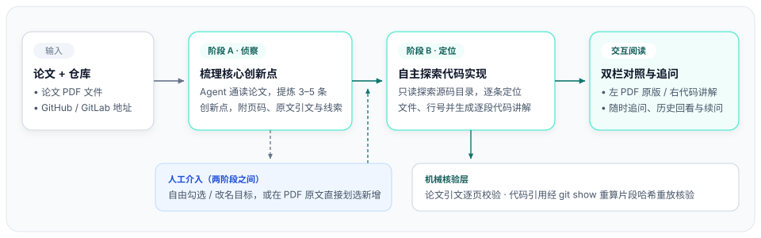
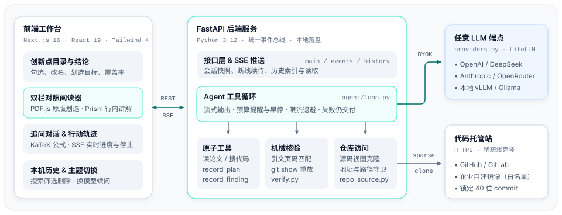

# Paper2code

**论文创新点 ↔ 代码实现的可核验对照阅读工具**

上传一篇论文 PDF 和对应的代码仓库地址，Agent 会自主通读论文、探索源码，把核心创新点逐条定位到具体文件与代码行，并在双栏阅读器中附带逐段讲解、公式排版与随时追问。每一条论文引文与代码引用都由后端机械核验，仓库里没有实现时直接如实告知。

[](LICENSE)


---

## 为什么你需要它

读论文配代码时，最耗时间的往往不是看懂大意，而是**把论文里的公式、模块和训练技巧，精确对应到仓库里的具体文件和代码行**。

把论文和代码丢给普通对话模型，它很容易写出一篇流畅的总结，但你很难确认它引用的页码、文件路径和行号是不是编的。Paper2code 把**可核验**做成默认工作流：

- **定位直达源码**：自动提炼论文的核心创新点并追踪到对应代码行，省去在大仓库里盲搜的时间。
- **引用经得起查证**：论文引文逐页匹配原文，代码引用锚定到具体 `commit`、行号与片段哈希，点击即可并排对照。
- **没有就说没有**：遇到仓库未实现的部分直接标注 `not_found` 并附搜索记录，避免顺着幻觉白费时间。

---

## 核心特性

- **两阶段自主探索 + 人工介入**：先读论文梳理核心创新点，再只读探索仓库定位代码；两阶段之间可自由勾选、编辑，或在 PDF 原文直接划选任意段落追加为定位目标。
- **双栏对照阅读与行内讲解**：左栏原版 PDF（支持页码直跳、无闪烁缩放、跨行引文高亮与直接划选），右栏 Prism 语法着色代码，AI 逐段讲解直接嵌在对应代码行前。
- **全链路机械核验**：论文引文核对页码与原文，代码引用由后端经 `git show` 重算片段哈希重放校验，核验结果与模型置信度分开展示。
- **可核验追问 & 公式渲染**：针对单条创新点或整篇论文继续追问，Agent 可按需再去翻论文和代码；回答中的 `文件:行号` 自动核对，数学公式由 KaTeX 渲染。
- **本机历史与换模型续问**：解读结果与对话自动落盘，支持搜索、状态筛选与删除；随时免密钥回看，或切换模型与中/英文解析语言继续追问。
- **BYOK 自由接入模型**：支持 OpenAI、DeepSeek、Anthropic、OpenRouter、SiliconFlow、vLLM、Ollama 等任意兼容端点，内置工具调用自检、限流自适应与手动深浅色外观切换。

---

## 工作原理

### 两阶段对照流程

<picture>
  <source media="(prefers-color-scheme: dark)" srcset="docs/images/workflow-dark.svg" />
  <source media="(prefers-color-scheme: light)" srcset="docs/images/workflow-light.svg" />
  
</picture>

### 系统架构

<picture>
  <source media="(prefers-color-scheme: dark)" srcset="docs/images/architecture-dark.svg" />
  <source media="(prefers-color-scheme: light)" srcset="docs/images/architecture-light.svg" />
  
</picture>

三个核心设计取舍：

1. **后端极薄、Agent 自主**：后端只提供原子只读工具与确定性校验，由 Agent 自主决定读哪页、搜什么、何时收敛。
2. **结构化提交走工具**：通过 `record_plan` 与 `record_finding` 增量提交，便于实时渲染并在格式或证据有误时定向打回重写。
3. **单 run 统一事件流**：侦察、定位、追问共用一条 SSE 流（支持断线续传），完整记录可观测行动轨迹。

### 核验边界

| 对象 | 核验方式 | 能证明 | 不能证明 |
|---|---|---|---|
| 论文引文 | 忽略空白差异核对是否出现在指定页（仅开头匹配标为「部分匹配」） | 这句话真实出现在该页 | 该句足以支撑模型推论 |
| 代码引用 | 从 `git show <commit>:<path>` 提取行区间并重算 `snippet_sha256` | 引用指向该 commit 真实存在的代码行 | 这些行在语义上完整实现了该公式 |
| 追问 `文件:行号` | 自动抽取并逐条查 git 对象核对存在性与行范围 | 代码位置真实存在 | 回答本身推理完全正确 |

---

## 快速开始

### 一句话交给你的 AI 助手完成部署（推荐）

如果你正在使用 Claude Code、Codex、Cursor 等 AI 编程助手，直接把下面这段话发给它即可自动完成拉取、环境配置与启动：

```text
请帮我拉取并本地部署 https://github.com/Anatkhior/Paper2Code.git ：检查本机是否具备 Python 3.11+、Node.js 22.13+、pnpm 和 git 2.25+（缺少 Python 3.12 可用 uv 安装），分别完成 backend（uv venv + pip install -r requirements.txt）与 frontend（pnpm install）的依赖安装，生成合成测试夹具（tests.paper_fixture 与 tests.repo_fixture），通过 backend/scripts/dev_services.sh start 启动后端(8000)、本地假端点(8123)和前端(3000)并确认三项健康检查通过，最后把 http://localhost:3000 的试用参数发给我。
```

---

### 手动安装与启动

#### 环境要求

- **Python ≥ 3.11**（推荐 3.12，`litellm` 依赖 3.11+ 的 `typing.NotRequired`）
- **Node.js ≥ 22.13** 与 **pnpm**
- **git ≥ 2.25**（支持 `--filter=blob:none` 与稀疏检出）
- 辅助脚本基于 bash，推荐在 Linux 或 WSL 下运行

没有 Python 3.12 时可用 [uv](https://docs.astral.sh/uv/) 快速安装：

```bash
curl -LsSf https://astral.sh/uv/install.sh | sh
uv python install 3.12
```

#### 1. 安装依赖

```bash
git clone https://github.com/Anatkhior/Paper2Code.git
cd Paper2Code

# 后端
cd backend
uv venv --python 3.12 .venv
uv pip install --python .venv/bin/python -r requirements.txt

# 前端
cd ../frontend
pnpm install
```

#### 2. 零成本试用（无需 API Key）

项目内置本地假端点 `devtools/mock_provider.py` 与合成论文/仓库夹具，可零成本体验完整流程：

```bash
cd backend

# 首次使用：生成合成论文 PDF 与合成代码仓库
.venv/bin/python -m tests.paper_fixture
.venv/bin/python -m tests.repo_fixture

# 一键启动：后端(8000) + 本地假端点(8123) + 前端(3000)
./scripts/dev_services.sh start
```

打开 **http://localhost:3000**（开发模式请用 `localhost` 而非 `127.0.0.1`，避免 Next.js HMR 跨源拦截）：

1. **模型设置**：`base_url` 填 `http://127.0.0.1:8123/v1`、`api_key` 填 `mock-key`、`model` 填 `mock-model`，点击「运行自检」。
2. **上传论文**：拖入或选择 `backend/tests/fixtures/synthetic_paper.pdf`，点击「上传并开始侦察」。
3. **调整目标**：勾选创新点，或直接在「PDF 原版」上划选任意一段添加自定义目标。
4. **定位代码**：仓库地址填 `backend/tests/fixtures/sample_repo` 的**绝对路径**，点击「开始定位」。
5. **对照与追问**：在双栏阅读器查看原文高亮、代码与行内 AI 讲解，继续追问或前往「历史记录」体验恢复与换模型续问。

常用服务管理命令：

```bash
./scripts/dev_services.sh status        # 查看三服务状态（带健康检查）
./scripts/dev_services.sh logs backend  # 查看日志（backend | mock | frontend）
./scripts/dev_services.sh stop          # 停止全部服务
./scripts/dev_services.sh clean         # 仅清理可再生 PDF 缓存，保留全部历史与仓库
```

<details>
<summary>手动分别启动三个服务</summary>

```bash
# 终端 1：后端（PAPER2CODE_ALLOW_LOCAL_REPO_PATHS 仅用于本地测试/演示）
cd backend
PAPER2CODE_ALLOW_LOCAL_REPO_PATHS=true .venv/bin/python -m uvicorn app.main:app --port 8000

# 终端 2：本地假端点
cd backend
.venv/bin/python -m uvicorn devtools.mock_provider:app --port 8123

# 终端 3：前端
cd frontend
pnpm dev
```

后端启动后可访问 http://127.0.0.1:8000/docs 查看并调试 Swagger 接口。

</details>

#### 3. 接入你自己的模型（BYOK）

在「模型设置」选择预设（OpenAI / DeepSeek / Anthropic / 本地 Ollama）或手动填写：

```json
{
  "protocol": "openai-compatible",
  "base_url": "https://api.deepseek.com/v1",
  "api_key": "sk-...",
  "model": "deepseek-chat"
}
```

- 建议先点击「运行自检」：通过两轮工具调用确认模型具备稳定的 function calling 能力。
- 模型名本身带 `/`（如 OpenRouter 的 `anthropic/claude-...`、SiliconFlow 的 `Qwen/Qwen2.5-72B-Instruct`）在填写 `base_url` 时会原样发往端点；仅在未填 `base_url` 时按 LiteLLM 原生前缀路由。

---

## 配置项

后端配置通过 `PAPER2CODE_` 前缀环境变量或 `backend/.env` 提供（兼容旧 `PAPERLENS_` 前缀，进程环境变量优先于 `.env`），修改后需重启后端。列表类变量兼容逗号分隔与 JSON 数组。

| 变量 | 默认值 | 说明 |
|---|---|---|
| `PAPER2CODE_DATA_DIR` | `data` | 运行数据目录，每个 run 独立子目录 |
| `PAPER2CODE_MAX_TOOL_CALLS` | `40` | 单个阶段（侦察/定位）工具调用上限 |
| `PAPER2CODE_MAX_INPUT_TOKENS` | `1500000` | 单个阶段累计输入 token 上限 |
| `PAPER2CODE_WALL_CLOCK_SECONDS` | `600` | 单个阶段墙钟超时（秒） |
| `PAPER2CODE_CHAT_MAX_TOOL_CALLS` | `8` | 每条追问消息的工具调用上限 |
| `PAPER2CODE_CHAT_MAX_INPUT_TOKENS` / `PAPER2CODE_CHAT_WALL_CLOCK_SECONDS` | `400000` / `180` | 每条追问消息的 token 与时长上限 |
| `PAPER2CODE_PER_TURN_TIMEOUT_SECONDS` | `180` | 单次 LLM 请求超时（秒） |
| `PAPER2CODE_LLM_MAX_REQUESTS_PER_MINUTE` | `0` | 客户端主动节流；`0` 表示撞 429 或读到响应头后自适应 |
| `PAPER2CODE_LLM_MAX_RETRIES` | `5` | 限流或瞬时故障最大重试次数 |
| `PAPER2CODE_HTTP_USER_AGENT` | `Paper2code/0.1` | LLM 与探测请求 UA |
| `PAPER2CODE_MAX_UPLOAD_MB` / `PAPER2CODE_MAX_PAGES` | `50` / `50` | PDF 体积与页数上限 |
| `PAPER2CODE_REPO_ALLOWED_HOSTS` | `github.com,gitlab.com` | 仓库域名白名单，支持 `host:port` |
| `PAPER2CODE_REPO_CLONE_TIMEOUT_SECONDS` | `300` | 克隆超时（秒） |
| `PAPER2CODE_REPO_MAX_MB` | `200` | 克隆后工作区 + 对象库总磁盘上限（MB） |
| `PAPER2CODE_REPO_SPARSE` / `PAPER2CODE_REPO_SPARSE_EXCLUDE` | `true` / 空 | 源码视图稀疏克隆开关及追加排除规则（如 `!data,!/docs/assets`） |
| `PAPER2CODE_REPO_NETWORK_MODE` | `local` | `local` 适合单机自用（兼容 TUN/fake-ip 代理）；`hosted` 适合公网部署 |
| `PAPER2CODE_REPO_ALLOW_CIDRS` | 空 | 显式信任网段（如 `10.20.0.0/16`） |
| `PAPER2CODE_REPO_DNS_CROSSCHECK` | `auto` | 公网 DoH 交叉核验开关（`auto` 仅在 `hosted` 模式下启用） |
| `PAPER2CODE_ALLOW_LOCAL_REPO_PATHS` | `false` | 允许克隆本地目录（仅用于本地测试与演示） |
| `PAPER2CODE_CORS_ORIGINS` | `["http://localhost:3000","http://127.0.0.1:3000"]` | 前端来源白名单 |

前端配置仅有 `NEXT_PUBLIC_API_BASE`（默认 `http://127.0.0.1:8000`），可复制 `frontend/.env.local.example` 为 `.env.local` 修改后重新构建。

---

## API 概览

完整交互文档可在后端运行后访问 `/docs`。

| 方法 | 路径 | 说明 |
|---|---|---|
| GET | `/api/health` | 健康检查、预算上限与当前生效的限流节奏 |
| POST | `/api/provider/smoke-test` | 两轮工具调用启动自检与失败诊断 |
| POST | `/api/runs` | multipart 上传 PDF、provider 与 `output_language`，返回 `run_id` |
| GET | `/api/runs` | 本机历史列表，支持 `?q=` 搜索、`?status=` 状态筛选与分页 |
| DELETE | `/api/runs/{id}` | 删除一条非运行中的本机历史记录 |
| GET | `/api/runs/{id}/snapshot` | 获取历史快照、资源可用性、近期事件与游标 |
| GET | `/api/runs/{id}/trace` | 分页加载更早的行动轨迹（`?before=<event_id>`） |
| POST | `/api/runs/{id}/recon` | 启动阶段 A（侦察），产出创新点清单 |
| GET | `/api/runs/{id}/plan` | 读取服务端创新点清单（含用户自定义目标） |
| POST / PATCH / DELETE | `/api/runs/{id}/plan/items[/{item_id}]` | 增删改自定义定位目标 |
| POST | `/api/runs/{id}/locate` | 启动阶段 B（定位与核验）；可选 `commit`（40 位小写 SHA）固定版本 |
| GET / POST | `/api/runs/{id}/chat` | 读取对话记录 / 发起追问（支持切换模型与解析语言） |
| GET | `/api/runs/{id}/events` | 统一 SSE 事件流，支持 `Last-Event-ID` / `?from_id=` 续传 |
| GET | `/api/runs/{id}` | 读取事件历史与最新产物 |
| GET | `/api/runs/{id}/file` | 从锁定 commit 的 git 对象读取代码片段与上下文 |
| GET | `/api/runs/{id}/pdf` | 原样透传上传的 PDF |
| GET | `/api/runs/{id}/paper/page/{n}` | 读取单页原文；带 `?quote=` 时返回高亮矩形与覆盖率 |
| GET | `/api/runs/{id}/paper/page/{n}/image` | 服务端渲染单页 PNG（文字层异常时自动回退） |
| POST | `/api/runs/{id}/cancel` | 停止当前运行中的阶段 |

---

## 评估数字

评估指标全部由确定性纯函数（`backend/app/eval_metrics.py`）从产物统计得出，且验收脚本会用手工构造的错误产物验证指标能够准确掉分。

| 指标 | mock（脚本化理想 Agent） | 真实模型 + 真实论文 |
|---|---|---|
| 创新点清单召回（`plan_recall`） | 100% | 待补充 |
| 创新点清单准确（`plan_precision`） | 100% | 待补充 |
| 文件级召回（`file_recall`） | 100% | 待补充 |
| 文件级准确（`file_precision`） | 100% | 待补充 |
| 符号级召回（`symbol_recall`） | 100% | 待补充 |
| **引用可核验率（`citation_verifiable_rate`）** | **100%**（2/2） | 待补充 |
| 诚实报「未找到」（`honest_not_found_rate`） | 100% | 待补充 |

> ⚠️ `mock` 列为**离线基线**（脚本化假端点 + 合成夹具），用于验证评估链路与指标定义，**不代表真实模型能力**。

### 标注纪律（`backend/eval/goldset.yaml`）

1. **先标注、后运行**：人工读完论文与代码并写下标准答案、**冻结 repo 的 40 位小写 `commit_sha`** 后再运行系统。
2. **commit 必须冻结**：评估按冻结 commit 检出并在交付后核对版本，上游提交更新不影响历史标注。
3. **gold set 只看一次**：调参改提示词请另建调参集。

```bash
cd backend
# 离线基线（零成本，更新 eval/report.json & report.md）
.venv/bin/python -m eval.run_eval

# 真实模型（输出到独立的 eval/reports/<时间>-<标签>-<随机标识>.json/.md）
PAPER2CODE_EVAL_BASE_URL=https://api.deepseek.com/v1 \
PAPER2CODE_EVAL_API_KEY=sk-... \
PAPER2CODE_EVAL_MODEL=deepseek-chat \
.venv/bin/python -m eval.run_eval --provider real --goldset eval/goldset-real.yaml --label "DeepSeek-V3"
```

---

## 测试与验收

验收脚本自动隔离临时 `PAPER2CODE_DATA_DIR`（不写入 `backend/data/`），使用专属端口 `8231/8232`：

```bash
# 1. 一键运行全部 7 个里程碑离线验收（共 621 项断言；跑前先停掉 next dev）
cd backend && ./scripts/run_all_checks.sh

# 2. 后端单元测试（53 项）
cd backend && .venv/bin/pytest -q

# 3. 前端类型检查、Lint、行为单测（31 项）与生产构建
cd frontend && pnpm exec tsc --noEmit && pnpm lint && pnpm test && pnpm build

# 4. Playwright 浏览器端到端测试（需先运行 ./scripts/dev_services.sh start）
cd frontend && pnpm test:browser
```

<details>
<summary>查看 7 个里程碑验收脚本覆盖明细（共 621 项）</summary>

| 验收脚本 | 断言数 | 覆盖范围 |
|---|---:|---|
| `m0_check` | 38 | BYOK 抽象、启动自检诊断、自定义 UA、带 `/` 模型路由、SSE 回放与重启收尾 |
| `m1_check` | 164 | 阶段 A 侦察、引文核验与打回、先连流再启动、限流退避与响应头识别、瞬时故障重试 |
| `m2_check` | 194 | 阶段 B 定位、SSRF 三层判定矩阵、源码视图稀疏克隆、五类核验失败、预算提醒、冻结 commit |
| `m3_check` | 54 | 代码/论文阅读端点、路径穿越、旋转/跨行 PDF 高亮矩形、前端构建与页面结构 |
| `m4_check` | 54 | 指标可证伪性、gold set 卫生、真实评估路径离线回归、README 数字一致性 |
| `m6_check` | 63 | 划选新增自定义目标、清单 CRUD 并发守卫、前端全部行为单测与构建产物检查 |
| `m7_check` | 54 | 追问事件链、历史传参、单消息 8 次工具预算、回答内代码位置核对 |

</details>

---

## 安全与隐私

- **密钥隔离**：`api_key` 仅随请求体在内存中使用，不落盘、不写日志、不进错误堆栈；前端默认不持久化密钥，仅在显式勾选后存于当前浏览器 `localStorage`，切换端点或协议时自动清空。
- **不可信数据隔离**：论文、代码、README 与 `.gitattributes` 均作为待分析材料处理，系统提示词带防注入声明，且代码引用需通过机械核验。
- **仓库只读硬化**：仅允许 `https://` 与域名白名单，使用 `--depth 1 --filter=blob:none --sparse` 稀疏浅克隆，关闭 hooks、submodule、LFS 与符号链接（`core.symlinks=false`），全链路只读分析，不运行仓库代码。
- **部署边界**：面向单机自用设计；若公网部署，除开启 `PAPER2CODE_REPO_NETWORK_MODE=hosted` 外，需在外部补齐鉴权、配额与网络层隔离。

---

## 项目结构

<details>
<summary>展开完整目录树</summary>

```text
backend/
  app/
    main.py                FastAPI 全部端点（上传 / 历史 / 侦察 / 定位 / 追问 / 阅读 / SSE）
    providers.py           BYOK 唯一抽象层：LiteLLM 调用、自检、限流学习与错误诊断
    history.py             本机历史索引（history.json）、状态筛选、删除与快照恢复
    agent/loop.py          Agent 工具循环：流式、预算提醒、原地打转早停、finalize 钩子
    agent/tools/           论文工具、仓库工具、历史对话工具、record_plan / record_finding
    paper.py / paper_highlight.py  PDF 读取、引文核验与几何序列高亮定位
    repo_source.py         仓库访问层：地址判定、源码视图克隆、路径与软链守卫、搜索
    verify.py              确定性重放核验（citation_verifiable_rate 来源）
    plan.py / chat.py      可编辑创新点清单 / 追问对话与回答内代码位置核对
    events.py / store.py   统一事件总线、SSE 与运行目录原子落盘
    language.py / config.py / prompts.py / eval_metrics.py
  devtools/mock_provider.py  本地假端点（限流、断流、HTML 错页、坏参数等多种变体）
  scripts/                 m0–m7 验收脚本、harness.py、run_all_checks.sh、dev_services.sh
  tests/                   合成论文/仓库夹具及历史、评估、PDF 几何、追问与阅读回归单测
  eval/                    goldset.yaml、run_eval.py、离线基线 report.json / report.md
  pyproject.toml           pytest 配置
frontend/
  app/
    page.tsx               主工作台：准备区、创新点目录与详情、常驻阅读器、追问与轨迹
    history/page.tsx       本机历史解读：搜索、状态筛选、分页与删除
    layout.tsx / globals.css / error.tsx
  components/              Reader、PdfPage、PlanList、ComparePanel、ChatPanel、Timeline、
                           CoverageCard、ProviderForm、Markdown、ThemeToggle、Icon、Evidence
  lib/                     api、types、useRunSession、useReader、session、chatState、
                           syntax、codeAnnotations、markdownMath、toolLabels、providerStorage
  tests/browser/           Playwright 端到端回归（reader / history / math）
docs/
  v0-spec.md               详细架构规格、schema、安全清单与里程碑设计
  images/                  浅色 / 深色双版本架构图与工作流图（SVG）
```

</details>

每次运行的数据保存在 `backend/data/<run_id>/` 下（`paper.pdf`、`meta.json`、`history.json`、`events.jsonl`、`plan.json`、`artifact.json`、`chat.jsonl` 及锁定 commit 的 `repo/`）。

---

## 已知限制与路线图

**已知限制：**
- 真实论文 + 真实模型的评估数字尚未产出，默认 gold set 目前仅有 1 对合成夹具。
- 不支持扫描版 PDF（无内置 OCR），单篇上传上限 50MB / 50 页；暂未对架构图与公式接入视觉模型理解。
- 代码搜索为纯 Python 实现，在超大型仓库上受 4000 文件 / 8 秒预算约束（未扫完会如实标注）。
- 暂不支持需鉴权的私有仓库及多租户在线部署。

**路线图：**
- [ ] 使用真实论文与主流模型产出首批评估报告，扩充 `goldset`
- [ ] 多条创新点并行定位
- [ ] 将公式与架构图页图像接入多模态视觉模型
- [ ] 多 provider 兼容性矩阵
- [ ] 可选符号索引工具（tree-sitter）

---

## 常见问题

<details>
<summary>填了正常 GitHub 地址却报“解析到了内网/保留地址”</summary>

通常是因为本机开启了 Clash / Mihomo / sing-box 等 TUN + fake-ip 代理，本机 DNS 返回了 `198.18.x.x` 占位地址。默认 `local` 模式已自动放行并在时间线给出提示；若设为 `hosted` 模式，可通过 `PAPER2CODE_REPO_ALLOW_CIDRS=198.18.0.0/15` 显式信任。企业内网 GitLab / 镜像请同时将域名加入 `PAPER2CODE_REPO_ALLOWED_HOSTS`。
</details>

<details>
<summary>运行中途报 RateLimitError / 429 或连接瞬断</summary>

系统优先读取响应头限额，其次识别网关限流话术并自动降速重试；遇到连接中断或网关 5xx 会自动退避重试；额度用尽/欠费会直接提示不再重试。即便最终失败，已经定位并核验的结论仍会照常交付。如需手动钉死速率，可设置 `PAPER2CODE_LLM_MAX_REQUESTS_PER_MINUTE`。
</details>

<details>
<summary>自检返回一整页 HTML 或 403</summary>

部分套了 Cloudflare 的中转站会拦截 Python SDK 的默认 User-Agent。Paper2code 默认使用 `Paper2code/0.1`；若仍被拦截，可将 `PAPER2CODE_HTTP_USER_AGENT` 设为常规浏览器 UA 并重启后端。
</details>

<details>
<summary>仓库包含大体积视频或权重，克隆慢或超限</summary>

默认开启源码视图克隆（`--filter=blob:none --sparse`），实测含 83MB 演示视频的仓库可从 237MB 降至 2.3MB。冷门大二进制文件会在时间线点名，按提示补充 `PAPER2CODE_REPO_SPARSE_EXCLUDE=!*.xxx` 即可。
</details>

<details>
<summary>开发模式下页面能打开，但按钮点击无反应</summary>

请通过 `http://localhost:3000` 访问而非 `http://127.0.0.1:3000`（Next.js dev HMR 会拦截跨源请求导致前端未 hydration），同时确认 `NEXT_PUBLIC_API_BASE` 与后端端口一致。
</details>

---

## 参与贡献

欢迎提 Issue 与 PR。提交前请确认：

1. 为行为改动补充回归测试与验收断言，并确保 `cd backend && ./scripts/run_all_checks.sh` 与 `.venv/bin/pytest` 通过。
2. 修改前端后执行 `cd frontend && pnpm exec tsc --noEmit && pnpm lint && pnpm test && pnpm build`。
3. 保持三项工程约定：不写死服务商/模型（协议差异集中在 `providers.py`）；引用保持机械可核验；代码、日志与提交中不出现密钥。

## 致谢与许可证

基于 [FastAPI](https://fastapi.tiangolo.com/)、[LiteLLM](https://github.com/BerriAI/litellm)、[PyMuPDF](https://pymupdf.readthedocs.io/)、[sse-starlette](https://github.com/sysid/sse-starlette)、[Next.js](https://nextjs.org/)、[React](https://react.dev/)、[Tailwind CSS](https://tailwindcss.com/)、[PDF.js](https://mozilla.github.io/pdf.js/)、[KaTeX](https://katex.org/) 与 [Prism](https://prismjs.com/) 构建。

本项目采用 [Apache License 2.0](LICENSE) 开源许可。
